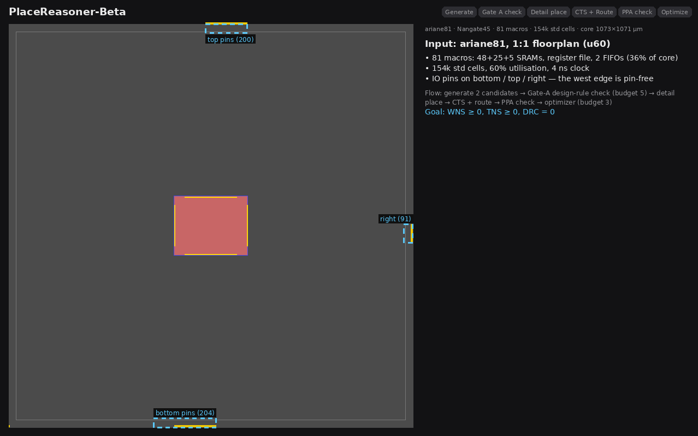
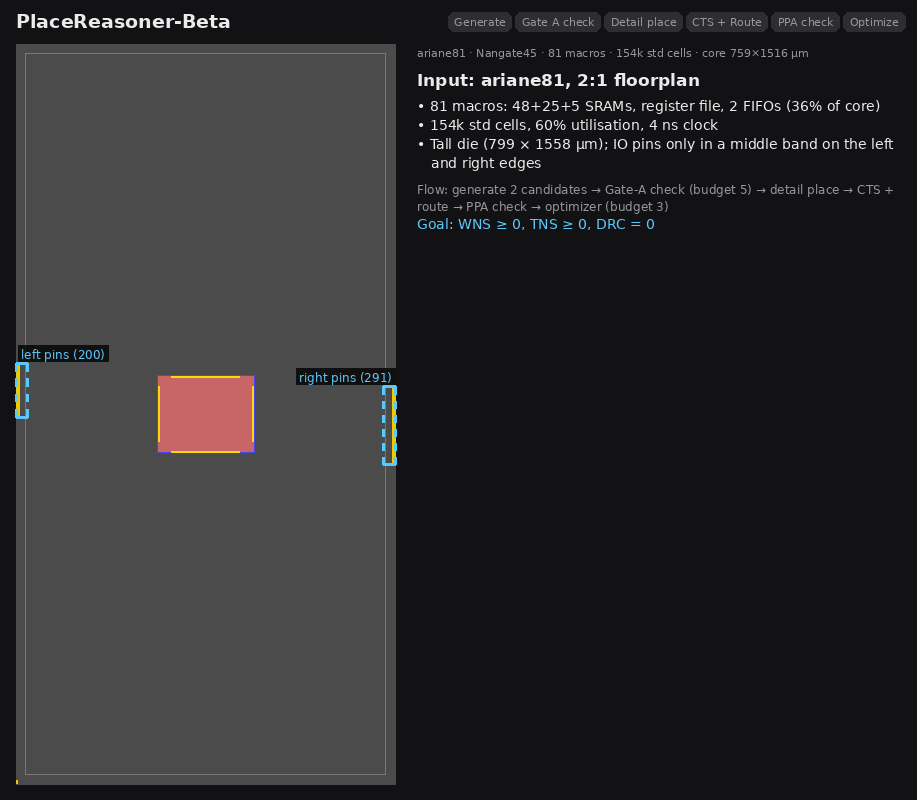

# PlaceReasoner-Beta

[](https://arxiv.org/abs/2609.21263)

Official implementation of
**[PlaceReasoner-Beta: Reasoning-Driven Macro Placement and Benchmarking](https://arxiv.org/abs/2609.21263)**.

**LLM-driven macro placement with routed PPA feedback.** PlaceReasoner-Beta
lets LLM agents decide where the macros of a design go on **OpenROAD**
(Nangate45). Every placement candidate is then taken through a *fixed*
downstream flow (detailed placement → CTS → routing) only to measure its
**routed** PPA (WNS / TNS / power / area / wirelength / DRC). That feedback
drives the next macro-placement refinement.

Only the macro placement is optimized. The downstream stages run the proven
templates from `skills/skills_Nangate45/` at their defaults and are never
tuned, so different macro placements (or models) are compared fairly.

```
init -> Planner -> Placer -> [Gate A: Checker on pin-side image] -> detail place -> CTS -> route
          ^                                                                  (fixed skill templates)
          |                                                                          |
          +----------- Optimizer (refine best placement) <---- routed PPA feedback --+
```

## Examples

Two full runs on **ariane81** (81 macros, 154k std cells, Nangate45, 60%
utilization, 4 ns clock), one per core aspect ratio. Each animation walks
through the flow: generate candidates → Gate-A check → detail place →
CTS + route → PPA check → Optimizer, then shows the routed winner and the
best-so-far TNS per optimizer iteration.

**1:1 floorplan** — 2 candidates, 2 Gate-A refinements, 3 optimizer
iterations (6 routed variants). Best: **WNS -0.02 ns · TNS -0.32 ns · DRC 0 ·
0.192 W** (first passing candidate: TNS -0.82 ns).

<p align="center">
  
</p>

**2:1 floorplan** — 2 candidates, 1 Gate-A refinement each, 3 optimizer
iterations (6 routed variants). Best TNS: **WNS -0.03 ns · TNS -0.19 ns ·
DRC 3 · 0.194 W** (best initial candidate: TNS -19.45 ns). DRC-clean
alternative: WNS -0.04 ns · TNS -4.45 ns · DRC 0.

<p align="center">
  
</p>

## Showcase

Macro placement of **ariane133** (Nangate45, 60% utilization, core aspect
ratio 2:1) by ten methods. Each panel shows the macro placement and its
post-route outcome: `failed` means the downstream flow could not converge
(DRC / timing); otherwise the total negative slack (TNS) and DRC count are
given. The last panel is the fully routed layout of the LLM agent result
(TNS = -0.08 ns, DRC = 0).

<p align="center">
  
</p>

## How it works

| Step | Who | Skill (`skills/skills_Nangate45/`) |
|---|---|---|
| Init: read LEF/LIB/Verilog/SDC + the predefined floorplan DEF | Python + OpenROAD | `0.init` |
| Plan a macro shape (periphery, pin sides inward, clusters together, contiguous ~AR-1 stdcell region) | **Planner** (LLM) | `1.macro_place/SKILL_planner.md` |
| Emit macro coordinates + orientation; Python legalizes (`legalize.py`) and places | **Placer** (LLM) | `1.macro_place/SKILL_planner.md` |
| Gate A: judge the pin-side-highlighted image; refine on FAIL | **Checker** (LLM) | `1.macro_place/SKILL_checker.md`, `macro_pin_side` |
| Detailed placement (FIRM macros, 5 µm halo, PDN, global + detailed place) | Python + OpenROAD, fixed | `2.detail_place` |
| CTS + global/detailed route | Python + OpenROAD, fixed | `3.post_detail_placement` |
| Read routed WNS/TNS/power/area/WL/DRC; pick the best candidate | Python | `4.PPA_checker` |
| Propose refined placements of the best candidate from its routed PPA | **Optimizer** (LLM) + geometric variants | `5.optimizer` |

- `flow.macro_candidates` distinct shapes are explored in isolated parallel
  worker processes (each owns its own OpenROAD session).
- `flow.post_route_opt_loops` optimizer rounds then refine the global best;
  the loop stops early when no variant improves on it.
- Every layout image is rendered by OpenROAD `save_image` (whole die + IO pins).
- The LLM is reached through the OpenAI Responses API (or any
  OpenAI-compatible endpoint via `openai.base_url`; `provider: vllm` for a
  local vLLM server).

## Setup

Requirements: `openroad` on `$PATH`, Python ≥ 3.9 with `openai`, `pyyaml`,
`pillow`.

```bash
pip install openai pyyaml pillow huggingface_hub
```

Benchmark data is **not** in this repository (~589 MB). Fetch it from
HuggingFace into `Benchmark/PlaceReasoner-Bench/`:

```bash
hf download fenggev566/PlaceReasoner-Bench \
  --repo-type dataset --local-dir Benchmark/PlaceReasoner-Bench
```

**PlaceReasoner-Bench** has 8 open-source designs on Nangate45: `ariane133`,
`ariane81`, `bp_be`, `bp_fe`, `ethernet`, `swerv_wrapper`, `vga_lcd` and
`VeriGPU`. Each one is at 60% core utilization under two core aspect ratios
(1:1 and 2:1), which gives 16 placement tasks. See
[`Benchmark/README.md`](Benchmark/README.md) for top module names, macro
counts and clock periods.

API key: export `$OPENAI_API_KEY`, or see [`API_key/README.md`](API_key/README.md).

## Run

```bash
export OPENAI_API_KEY=...

# bp_fe, core aspect ratio 2:1
python run_flow.py \
  --data-dir Benchmark/PlaceReasoner-Bench/bp_fe \
  --design bp_fe --top bp_fe_top \
  --floorplan-def def/2_1_floorplan.def      # ar1: def/1_1_u60_floorplan.def
```

Useful overrides (defaults come from `config.yaml`):

| Flag | Meaning |
|---|---|
| `--macro-candidates N` / `--parallel-workers N` | number of macro shapes / concurrent workers |
| `--gate-a-max-refine N` | Gate-A Placer refinement tries |
| `--post-route-opt-loops N` | Optimizer rounds on routed PPA (`0` = routed feedback only) |
| `--route-mode timing\|light` | `timing` (default): CTS + route with fixed, bounded, default-margin `repair_timing`. `light`: no timing repair (faster, less robust) |
| `--work-dir DIR` | output directory (default `log_debug/<timestamp>_<design>/`) |
| `--stop-after placement\|route` | stop early at a checkpoint |
| `--config FILE` | model / loop config (default `config.yaml`) |

Offline self-test (fake LLM + fake OpenROAD, no API calls):

```bash
python -m macroflow.selftest
```

### Coding-agent driven (Claude Code / Codex)

The same loop can be driven by an interactive coding agent instead of the API
orchestrator. See [`Instructions/macro_placement_loop.md`](Instructions/macro_placement_loop.md):

```bash
claude      # or: codex
> Read Instructions/macro_placement_loop.md and run it with DESIGN=bp_fe ASPECT=ar2.
```

## Config (`config.yaml`)

- `provider` + `openai:` — model, reasoning effort, token budget, key file,
  optional `base_url`.
- `flow:` — `macro_candidates`, `parallel_workers`, `gate_a_max_refine`,
  `post_route_opt_loops`, `optimizer_variants`, `vlm_place_coords`,
  `route_mode`.
- `image:` — `save_image` width, margin and IO-pin overlay.

Technology files live in `Digital_lib/Nangate45` (`--tech-dir` to change);
design-specific macro LEF/LIB (FakeRAM) stay in `<data-dir>/{lef,lib}`. The
macro cluster file `<data-dir>/<design>_macro_clusters.txt` feeds the Planner.
Regenerate it with [`dataflow/rtlmp`](dataflow/rtlmp/README.md) if it is missing.

## Outputs (under `--work-dir`)

| Path | Content |
|---|---|
| `candidates/` | merged candidate ledger: per candidate `strategy.txt`, `coords.json`, `metrics.json` (incl. `routed` PPA), `gate_a.json`, images, ODBs; `index.json` |
| `model_output/run/summary.txt`, `telemetry.json` | best candidate, routed PPA, tokens, LLM / OpenROAD runtime |
| `candidate_workers/`, `post_route_workers/` | isolated per-worker runs (scripts, logs, reports) |
| `images/` | init, macro placement, pin-side, detail-placed and routed snapshots |
| `output/latest_<design>_result.json` (project root) | compact result record; `output/results.jsonl` appends every run |

## Layout

```
run_flow.py              entry point
config.yaml              model + macro-loop config
macroflow/               orchestrator, agents (Planner/Placer/Checker/Optimizer),
                         OpenROAD session, geometry, metrics, candidates, telemetry
legalize.py              force-directed macro legalizer
skills/skills_Nangate45/ skills + fixed TCL templates (init, macro place, detail
                         place, CTS/route, PPA checker, optimizer, pin-side image)
Digital_lib/Nangate45/   PDK (std-cell lib, tech LEF, cell LEF)
dataflow/rtlmp/          macro-cluster generator (RTL-MP style dataflow clustering)
Benchmark/               PlaceReasoner-Bench (download separately)
Instructions/            coding-agent prompt for the same loop
docs/images/             figures used in this README
```

## Citation

If you use this code or PlaceReasoner-Bench, please cite:

```bibtex
@article{li2026placereasoner,
  title={PlaceReasoner-Beta: Reasoning-Driven Macro Placement and Benchmarking},
  author={Li, Qiufeng and Wang, Chengxuan and Chen, Rongqian and Cheng, Quan and Ren, Yihui and Ho, Chia-Tung and Pan, David Z and Lan, Tian and Cao, Weidong},
  journal={arXiv preprint arXiv:2609.21263},
  year={2026}
}
```

## License

See [LICENSE](LICENSE).
